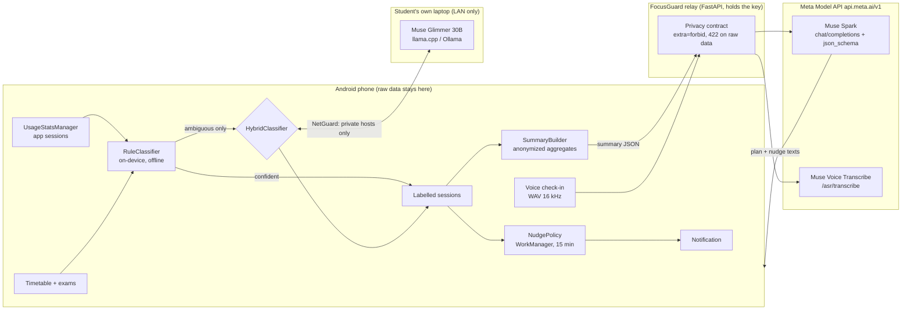

# FocusGuard

**An Android focus coach that senses how a student actually uses their phone during study blocks, and plans tomorrow around it, without the raw usage ever leaving devices the student owns.**

**Demo video:** https://youtu.be/WrLV5ZXMlqM

Built for the Meta Global AI Developer Hackathon 2026 · Indie track · theme *"Build for Your World"*.

>  My world is a 3rd-year engineering timetable, an exam 9 days away, and a phone that turns "one quick YouTube lecture" into an hour of Shorts. Screen-time apps show you a pie chart after the damage is done. FocusGuard steps in *during* the study block and plans the next day from what really happened.


---

## What it does

| | |
|---|---|
| **Senses** | Reads foreground app sessions with Android `UsageStatsManager` (Usage Access permission) and knows when you are inside a study block from your timetable. |
| **Classifies on your own hardware** | Every session is labelled *focused / distracted / neutral*. A rule engine on the phone handles the obvious ones instantly. The ambiguous ones (YouTube during a study block: lecture or rabbit hole? Chrome: research or browsing?) go to **Muse Glimmer**, Meta's open-weight model, running on the student's own laptop over local Wi-Fi. It sees the neighbouring apps ("YouTube between Acrobat and Google Docs at 18:26") and decides. |
| **Nudges in the moment** | A background check every 15 minutes (offline, rules only) sends a notification when distracted time inside the current study block crosses your threshold, using nudge texts Muse Spark wrote for *your* pattern. |
| **Plans tomorrow with Muse Spark** | Only an **anonymized daily summary** (minutes per category, an hourly distraction histogram, timetable, exam countdowns, no app names) goes through a thin relay to **Muse Spark** on the Meta Model API, which returns a structured plan: time blocks, exam strategy, a realistic focus goal and personalised nudge texts. The *What leaves my phone?* button shows the exact JSON first. |
| **Voice check-in** | Hold-to-talk: *"DBMS normalization for ninety minutes, but I keep checking Instagram."* **Muse Voice Transcribe** transcribes it, Muse Spark turns it into structured intent (subject, minutes, blockers), and that intent feeds tonight's plan. |

FocusGuard is not a chatbot and gives no health or wellness advice. It is a behaviour-sensing scheduler.

## Meta models used, and where

| Model | Where it runs | What it does in FocusGuard | Code |
|---|---|---|---|
| **Muse Glimmer** (open weights, 30B, Apache-2.0) | Student's own laptop/desktop via llama.cpp / Ollama / LM Studio (OpenAI-compatible), reached over the LAN | Judges *ambiguous* app sessions using context (neighbouring apps, time, study block) | `android/.../classify/MuseGlimmerClassifier.kt`, `core/GlimmerProtocol.kt`, `core/Classifier.kt` (`HybridClassifier`) |
| **Muse Spark** (`muse-spark-1.3`, Meta Model API) | Cloud, via the relay | Turns the anonymized daily summary into a structured study plan (JSON-schema structured output); extracts intent from voice check-ins | `backend/app/meta_client.py`, `backend/app/prompts.py`, `backend/app/main.py` |
| **Muse Voice Transcribe** (`muse-voice-transcribe-1.0`, Meta Model API) | Cloud, via the relay | Transcribes the voice study check-in (WAV, 16 kHz mono, recorded on the phone) | `android/.../voice/WavRecorder.kt`, `backend/app/meta_client.py` |

**Why not Muse Glimmer on the phone itself?** Glimmer is a dense 30B model; Meta's published quantized builds are 17–20 GB, which no phone can hold in RAM. So the private tier is "hardware the student owns" (their laptop on the same Wi-Fi), and the phone always has the rule engine, so FocusGuard works with no laptop and no network at all.

## Architecture



## Privacy model

1. **Raw sessions (app, time, duration) never leave the phone**, except optionally to *your own* Muse Glimmer server. `NetGuard` refuses any non-private host (only `10.x`, `192.168.x`, `172.16–31.x`, `localhost`, `*.local`, Tailscale `100.64/10`) unless you flip an explicit "allow non-local host" switch, and only ambiguous sessions are sent.
2. **What reaches Meta's cloud is aggregates only**, plus, if you did a voice check-in, the one-line summary of what *you said* (your own words; package names are scrubbed). The relay's Pydantic models use `extra="forbid"`: a payload with any extra field (such as a `sessions` or `top_apps` list) or package-name-looking strings is rejected with HTTP 422 *before* any call to Meta (covered by tests). The phone also scrubs package names from free text.
3. **The Meta API key lives on the relay**, read from environment variables. It is never compiled into the app or committed.
4. **Nudges work fully offline** with the rule engine; no server is needed to get value.
5. The relay stores nothing.

## Repository layout

```
android/   Kotlin + Jetpack Compose app (minSdk 26, targetSdk 35), Gradle wrapper included
  core/      pure-Kotlin logic: categories, RuleClassifier, HybridClassifier, SummaryBuilder,
             NudgePolicy, Timetable parser, NetGuard, Glimmer protocol  (JVM unit-tested)
  classify/  MuseGlimmerClassifier (OpenAI-compatible HTTP to your own Glimmer server)
  data/      UsageRepository (UsageStatsManager), SettingsStore, DemoData
  net/       RelayClient + tiny HttpURLConnection helpers
  voice/     WavRecorder (AudioRecord -> WAV)
  work/      NudgeWorker + notifications
  ui/        Onboarding, Today, Plan, Settings screens
backend/   FastAPI relay to the Meta Model API, with pytest suite and offline mock mode
docs/      DEMO_SCRIPT.md, SUBMISSION_NOTES.md, FORM_ANSWERS.md, GLIMMER_LOCAL.md, BUILD_STATUS.md
```

## Setup and run

### 1. Relay (backend)

```bash
cd backend
python -m venv .venv && source .venv/bin/activate      # Windows: .venv\Scripts\activate
pip install -r requirements.txt
pytest -q                                              # all tests pass, no network or key needed

# Live mode: put the key from https://dev.meta.ai (Model API dashboard) in backend/.env.
# The relay loads backend/.env automatically; never commit that file.
# META_API_KEY=LLM|...
export META_MODEL=muse-spark-1.3                       # optional (default)
export META_API_BASE=https://api.meta.ai/v1            # optional (default)
uvicorn app.main:app --host 0.0.0.0 --port 8000
curl http://localhost:8000/health                      # {"mode":"live", ...}
```

Without `META_API_KEY` (or with `FOCUSGUARD_MOCK=1`) the relay runs in **offline mock mode**: deterministic plans and a canned check-in, every response labelled `"source": "mock"`. Use it to demo without a key; never present mock output as a model result.

| Env var | Default | Meaning |
|---|---|---|
| `META_API_KEY` (or `MODEL_API_KEY`) | – | Meta Model API key. Missing ⇒ mock mode |
| `META_API_BASE` | `https://api.meta.ai/v1` | API base URL |
| `META_MODEL` | `muse-spark-1.3` | Planning / intent model |
| `META_ASR_MODEL` | `muse-voice-transcribe-1.0` | Voice check-in model |
| `FOCUSGUARD_MOCK` | `0` | `1` forces offline mock |
| `RELAY_TOKEN` | – | If set, the phone must send it as `X-Relay-Token` |

### 2. Muse Glimmer on your laptop (optional, for the hybrid classifier)

See [`docs/GLIMMER_LOCAL.md`](docs/GLIMMER_LOCAL.md). Short version (llama.cpp ≥ b10353, ~17 GB Q4_K_M GGUF, needs a machine with ~24 GB of free RAM/VRAM):

```bash
llama serve -hf meta-models/Muse-Glimmer-30B-GGUF \
  --hf-file Muse-Glimmer-30B-KQuant-17GB-Q4_K_M.gguf \
  -a muse-glimmer -ngl 99 -c 32768 -np 1 --no-mmproj \
  --host 0.0.0.0 --port 8080 \
  --chat-template-kwargs '{"reasoning_strength":"low"}'
```

Then in the app: Settings → Muse Glimmer judge → on, URL `http://<laptop-LAN-IP>:8080/v1`, model `muse-glimmer`, *Test Glimmer connection*.

### 3. Android app

1. Open `android/` in Android Studio (Koala or newer; AGP 8.5.2, Kotlin 2.0.20, JDK 17). Let Gradle sync.
2. Run on a phone (Android 8+) or emulator.
3. Onboarding → *Open Usage Access settings* → enable FocusGuard. On an emulator with no history, tap *Use labelled demo data instead*.
4. Allow notifications and microphone when asked.
5. Settings → Relay URL: emulator `http://10.0.2.2:8000`, real phone `http://<laptop-LAN-IP>:8000` (same Wi-Fi).

## Demo flow (what the video shows)

1. **Today**: focused vs distracted minutes, each session with its label, reason and *source* (`rules` vs `muse-glimmer`).
2. Toggle Muse Glimmer on → refresh → the ambiguous 18:26 YouTube session between Acrobat and Docs flips to *focused* ("lecture between PDF and notes"), labelled `muse-glimmer`.
3. **Check nudge now** → notification "DSA: N min off-task…" (in demo-data mode the check simulates 19:40 inside the weekday DSA block, so it works at any hour).
4. **Voice check-in** → transcript + structured intent.
5. **Plan** → *What leaves my phone?* shows the aggregate JSON (no app names) → *Generate plan* → Muse Spark plan with `source: muse-spark-1.3`.
6. Backend terminal: `curl` a summary containing raw `sessions` → **422** (the privacy contract).

Full script with timings: [`docs/DEMO_SCRIPT.md`](docs/DEMO_SCRIPT.md).

## Built during the hackathon

All code in this repository was written during the hackathon window (Oct 26 – Nov 4, 2026). The Android app, rule classifier, Muse Glimmer / Muse Spark / Muse Voice Transcribe integration, privacy contract, nudges, UI, FastAPI relay and tests were all built for this event. The git history of this repo starts during the event.

## Testing status

- `backend/`: 18 pytest tests pass (privacy contract, mock mode, live-mode request shape against a mocked Meta API, upstream errors, voice check-in, and a summary generated by the Android code).
- `android/`: 11 JVM unit tests for the pure-Kotlin core pass, and the debug APK assembles.
- Verified end to end on an Android emulator (API 37) with a live Meta Model API key: the Plan screen returns a muse-spark-1.3 plan through the relay. Muse Glimmer (optional laptop tier) is documented but optional.

## License

MIT, see [LICENSE](LICENSE). Muse Glimmer weights are Apache-2.0 (Meta); Muse Spark and Muse Voice Transcribe are used through the Meta Model API under Meta's terms.
